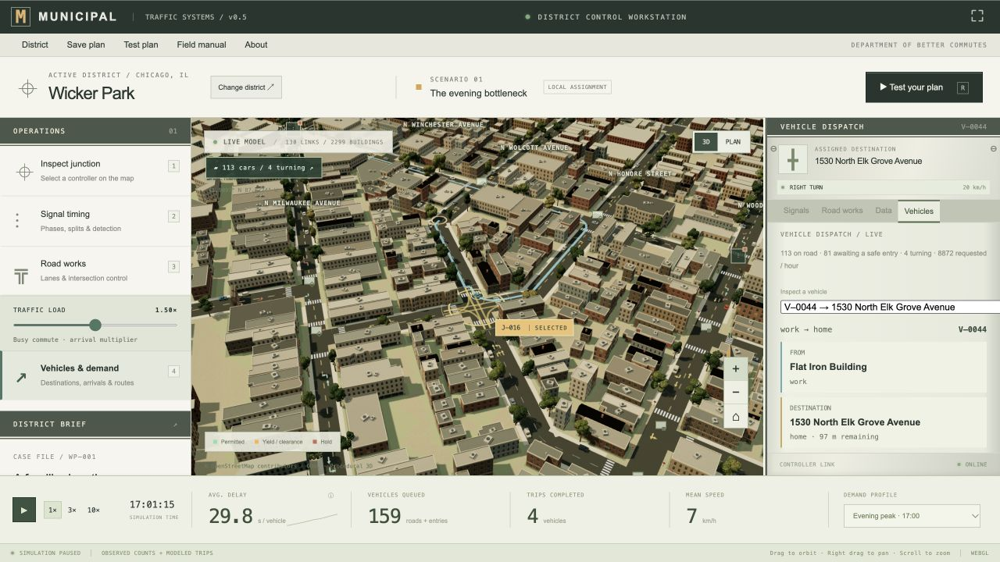

# MUNICIPAL — Traffic Control Simulator

A traffic engineering game for the neighborhoods you know. Take charge of a real-world map, tune the signals and reshape intersections to keep the evening commute moving.



Textured façades, varied roofs, street trees, detailed vehicles and mapped parks are generated directly from the district data. [Promotional cover art](municipal/public/art/municipal-cover.webp).

## Features

- Search OpenStreetMap, move the district pin, and import up to a 2.7 km square of streets and buildings.
- Program fixed-time/actuated signals, protected left arrows and pedestrian WALK/clearance stages in a live controller cabinet.
- Inspect lane right-of-way on the map and follow individual cars along smooth turning paths to named destinations.
- Feed traffic from highway/arterial gateways and local building activity, with visible arrival estimates and adjustable traffic load.
- Convert signals and all-way stops, widen approaches, and add left-turn bays within a public works budget.
- Compare your design against the original in matched, seeded traffic simulations.
- Play a Chicago scenario informed by dated city traffic counts, or import compatible local counts from CSV.
- Learn how green times, detector gaps, queues and coordination interact in the built-in field manual.

[Play MUNICIPAL](https://nascarjake.github.io/traffic-manager/)

The traffic model combines observed counts where available with estimated trip patterns. It is an educational game and is not validated for real-world engineering decisions. Satellite imagery and photogrammetric tiles are not currently integrated.

## Run locally

Node 20+ and Python 3 are sufficient; no dependency installation is required.

```sh
cd municipal
npm run dev
```

Open http://127.0.0.1:5173. See [the technical README](municipal/README.md) for controls, data sources, simulation assumptions, asset provenance, and tests.
